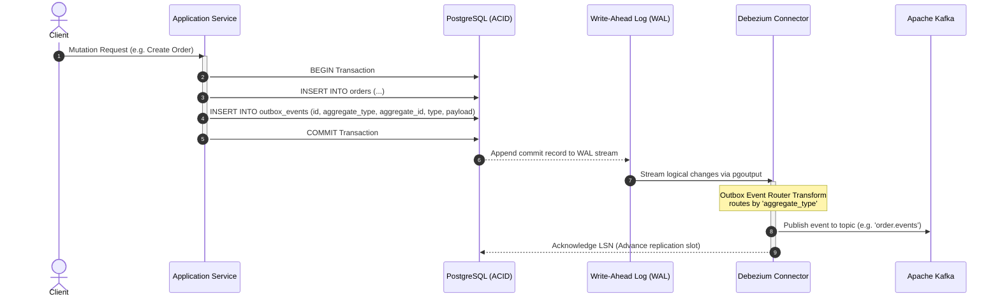

# Change Data Capture (CDC) via Debezium & Kafka Connect

## 1. When to read this
Read this when scaling the Transactional Outbox pattern beyond database polling limits (> 10,000 events/sec), eliminating polling database CPU and IOPS load, streaming zero-data-loss database changes directly from transaction logs (PostgreSQL WAL, MySQL Binlog), and managing event schema evolution.

---

## 2. Decision table

| Question | Smallest mechanism that holds the invariant | Take more complex mechanism only when |
|---|---|---|
| Outbox volume $< 5,000$ events/minute? | **Database Polling Worker** using `SELECT ... FOR UPDATE SKIP LOCKED` (BE-2). | Native CDC engine (Debezium / Kafka Connect) when polling CPU and table bloat become a bottleneck. |
| Outbox volume $> 10,000$ events/second? | **Native CDC via Debezium** reading transaction logs without querying the DB engine. | Dedicated event-sourcing engines (e.g. EventStoreDB). |
| How to avoid database table bloat? | **CDC Log Tailing**: Debezium reads WAL inserts; outbox table can be truncated or partitioned by day and dropped without vacuuming updates. | Soft-delete markers with aggressive background cleanup. |
| How to prevent WAL disk accumulation? | **Heartbeat Action Table** regularly advancing the logical replication slot position. | Manual replication slot monitoring and automated disk alerts. |

---

## 3. Architecture: Outbox Pattern via CDC



### Advantages over Polling Outbox
1. **Zero Database Query Overhead:** Debezium connects as a PostgreSQL logical replication client (`pgoutput`). It does not run `SELECT` queries and consumes near-zero database CPU.
2. **Eliminates MVCC Table Bloat:** In polling outbox models, updating rows (`status = 'PUBLISHED'`) causes dead tuple accumulation in PostgreSQL, requiring frequent aggressive `VACUUM`. With CDC, rows are append-only and can be partitioned and dropped cleanly.
3. **Sub-10ms End-to-End Latency:** Events are read from the WAL the moment the transaction commits, rather than waiting for the next polling interval.

---

## 4. Operational Guardrails

### A. Heartbeat Table (Preventing WAL Disk Exhaustion)
If your application experiences low write activity on the outbox table, the PostgreSQL logical replication slot will not receive new commits and will not advance its LSN. The PostgreSQL server will retain all WAL segments on disk, eventually exhausting disk space and crashing the database.

**Solution:** Configure Debezium Heartbeat:
```json
{
  "connector.class": "io.debezium.connector.postgresql.PostgresConnector",
  "heartbeat.interval.ms": "10000",
  "heartbeat.action.query": "INSERT INTO debezium_heartbeat (id, last_heartbeat) VALUES (1, NOW()) ON CONFLICT (id) DO UPDATE SET last_heartbeat = EXCLUDED.last_heartbeat;"
}
```

### B. Event Schema Evolution with Schema Registry
When publishing CDC events across microservices, breaking payload changes will crash downstream consumer deserializers. Enforce backwards compatibility:
- Use **Avro** or **Protobuf** schemas registered in Confluent Schema Registry.
- Rules: Never rename or remove existing required fields; new fields must declare default values (`default = null`).
- Entity deletion events must emit a Kafka **Tombstone** record (a message with the entity ID as key and `null` as payload) so Kafka log compaction can garbage-collect the deleted aggregate.

---

## 5. Checklist for review
- [ ] Application writes domain state and outbox events in the same atomic database transaction.
- [ ] Outbox schema follows standard event envelope: `id`, `aggregate_type`, `aggregate_id`, `type`, `payload`, `created_at`.
- [ ] Debezium uses the `EventRouter` SMT (Single Message Transformation) to route events to domain topics by `aggregate_type`.
- [ ] Heartbeat query configured to advance the replication slot and prevent disk exhaustion.
- [ ] Event payloads use schema registry validation (Avro/Protobuf) with `BACKWARD` or `FULL` compatibility rules.

---

## 6. How to prove it
- **End-to-End Event Stream Test:** Execute a business mutation in the application; observe event emission on Kafka topic within $< 50\text{ms}$; verify payload schema validates against Schema Registry.
- **Transaction Rollback Invariant:** Initiate a database transaction that inserts an outbox event, then force a transaction `ROLLBACK`. Verify that Debezium emits zero messages to Kafka, proving transaction isolation.
